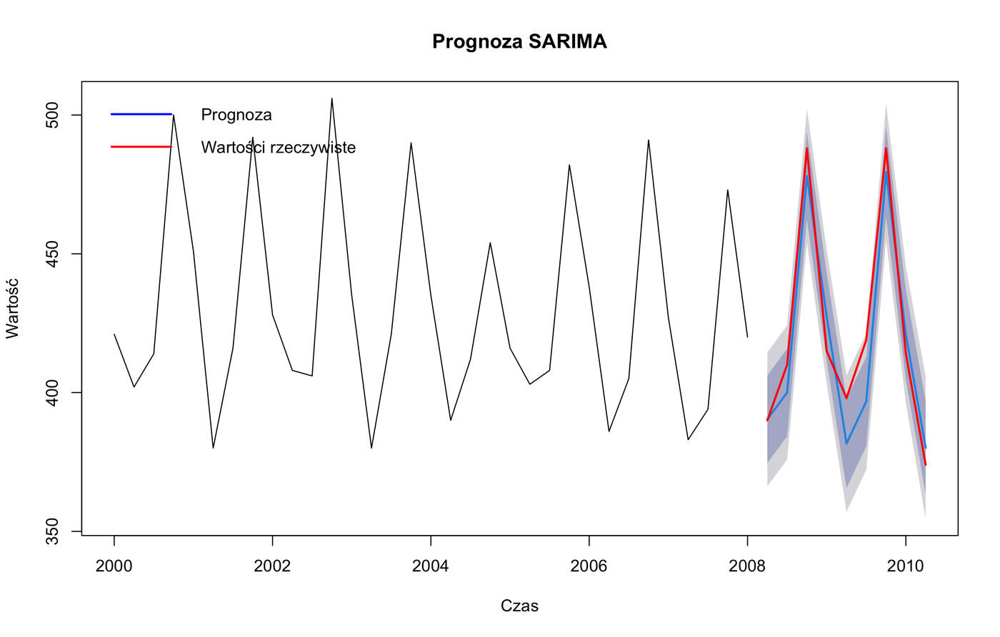
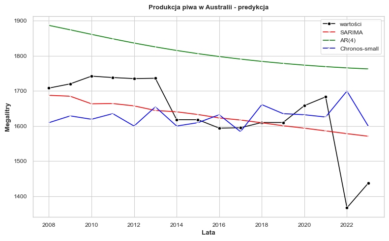

# Forecasting Australian Beer Production: Classical Models vs. a Foundation Model

**Time-series study of quarterly beer production in Australia (fpp2 `ausbeer`). Decomposition, outlier treatment, AR and SARIMA models, and Amazon's pretrained Chronos model, checked against real data for 2008–2023.**


**Question:** how will Australian beer production evolve in 2011–2023? The models are trained on 1990–2010 (82 quarterly observations, in megalitres) and then compared against what actually happened.

## Pipeline

1. **Exploration**: strong yearly seasonality, with a Q4 peak before the Australian summer and a Q2 low. There is a mild downward trend.
2. **Outliers**: three residual outliers (Q3 of 1990, 1991 and 2004) were flagged consistently by a |Z-score| > 2.9 rule and the IQR rule. They match the early-90s recession and the 2004 drought, and were smoothed so that the residuals meet independence and normality assumptions.
3. **Decomposition**: four trend estimators were compared on Ljung–Box, Shapiro–Wilk, R² and ACF/PACF: moving average, Box–Cox (λ = −4.4) with linear regression, Box–Cox with polynomial regression, and LOESS. The winner was **Box–Cox with a degree-2 polynomial trend** (R² = 0.86, Ljung–Box p = 0.21, Shapiro–Wilk p = 0.62).
4. **Models**
   - **AR(4)** on the decomposition residuals, selected by AIC/BIC (Yule–Walker)
   - **SARIMA(0,0,0)(2,1,0)[4]** selected by `auto.arima`, after an ADF test (p = 0.26, non-stationary) and residual checks (Ljung–Box, Shapiro–Wilk p = 0.063)
   - **Chronos (T5 Small)**: Amazon's pretrained, LLM-style forecaster that tokenises the series. Zero-shot, no fitting

## Results: cumulative yearly forecasts vs. reality, 2008–2023

| Model | MSE |
|---|---|
| **SARIMA(0,0,0)(2,1,0)[4]** | **≈ 6,622** |
| Chronos (T5 Small, zero-shot) | ≈ 12,342 |
| AR(4) + polynomial trend + seasonal means | ≈ 37,394 |

All three models predict declining production. The decomposition + AR approach is too optimistic, Chronos produces the most dynamic forecasts, and **SARIMA is the most accurate**.

<p align="center">
  
  
</p>
<p align="center"><em>Left: SARIMA hold-out forecast. Right: yearly production 2008–2023, actual (black) vs. SARIMA, AR(4) and Chronos.</em></p>

## Repository structure

```
src/beer_timeseries/   paths, Diebold–Mariano test (dm_test)
scripts/               decomposition, analysis (outliers, AR fit), forecast (SARIMA, Chronos)
data/raw/              Beer_to_2010.csv, cut_data.csv
results/               reference tables (decompositions, AR/SARIMA forecasts) and figures
archive/               exploratory and submitted versions
reports/               full report (PDF, in Polish)
```

## How to run

```bash
python -m pip install -e .
python -m scripts.decomposition
python -m scripts.analysis
python -m pip install -e ".[forecast]"   # torch + chronos-forecasting, needed for Chronos
python -m scripts.forecast
```

Tests: `python -m unittest discover -s tests`.

## Report

📄 [Full report (PDF, Polish, 18 pages)](reports/Produkcja_piwa_w_Australii.pdf)

**Authors:** Filip Gaj, Maciej Karawan. Time series analysis course project, January 2025.
